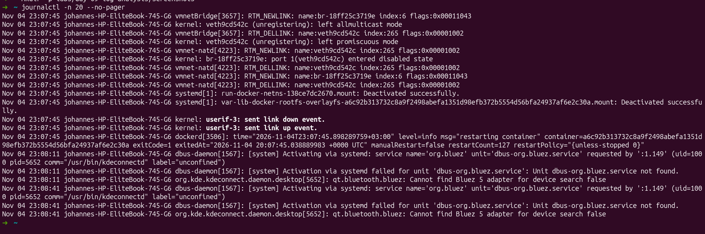
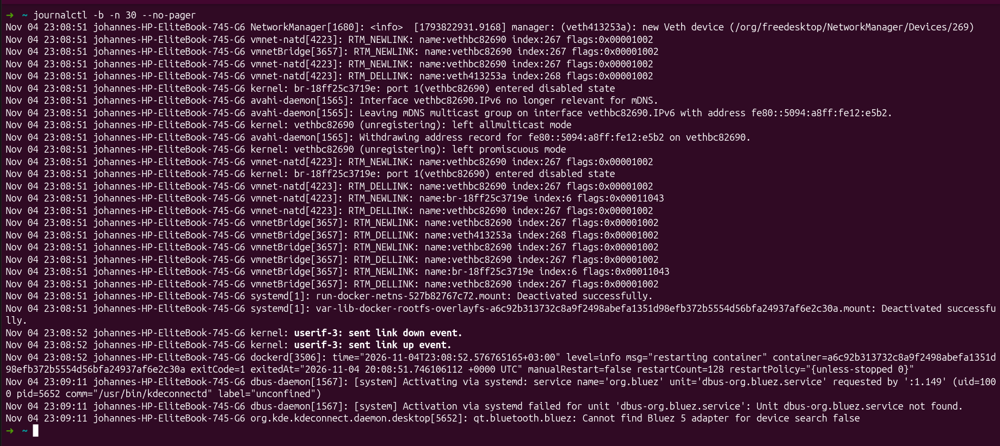
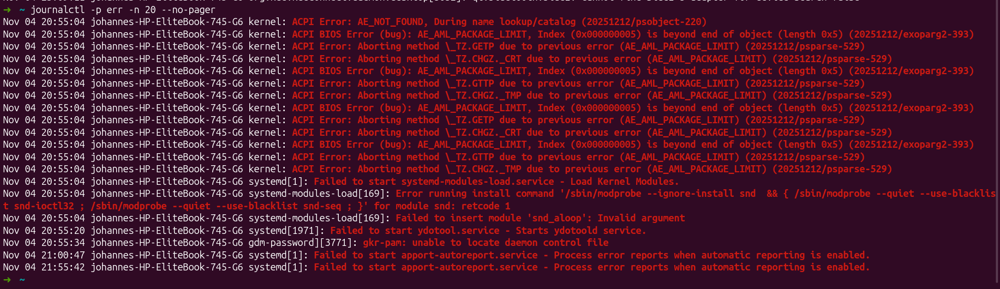
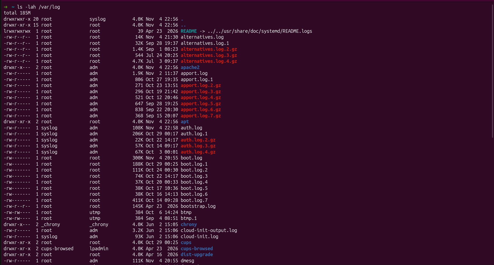
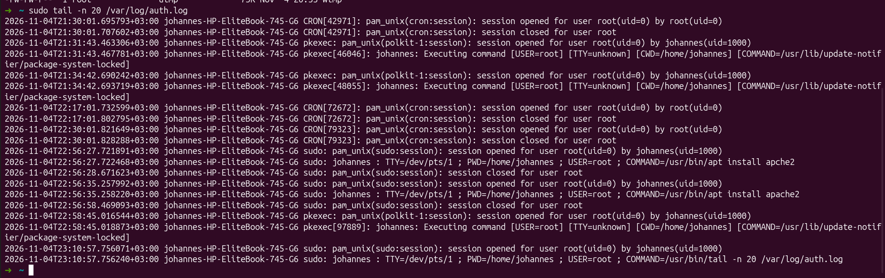

# Day 9 Lab — Linux Log Analysis

## Objective
Inspect Linux logs and identify system events.

## Tasks and Evidence

### 1. Recent Logs
```bash
journalctl -n 20 --no-pager
```


### 2. Current Boot Logs
```bash
journalctl -b -n 30 --no-pager
```


### 3. Error Messages
```bash
journalctl -p err -n 20 --no-pager
```


### 4. Available Log Files
```bash
ls -lah /var/log
```


### 5. Authentication Logs
```bash
sudo tail -n 20 /var/log/auth.log
```


## Findings
- Errors observed:
- Authentication activity:
- Important observations:

## Conclusion
Practiced inspecting Linux logs for troubleshooting and basic security monitoring.
